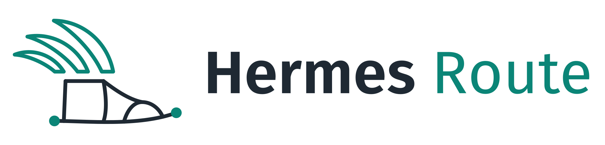
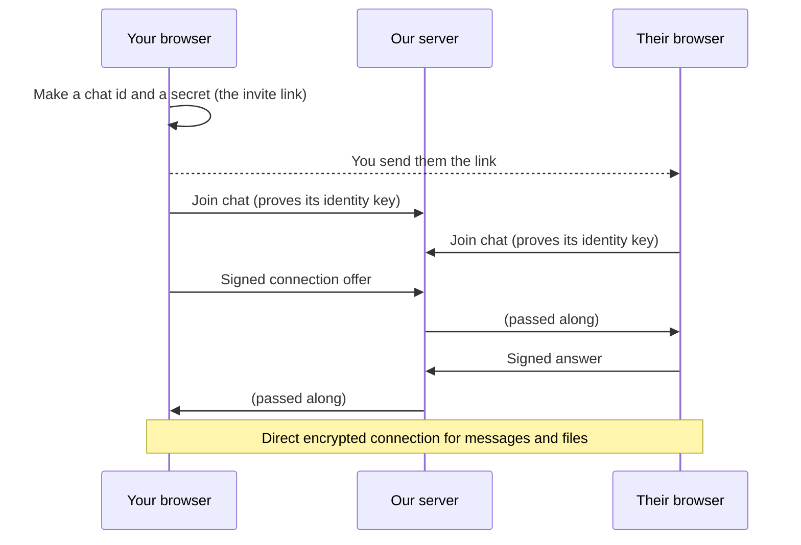

<p align="center">
  <picture>
    <source media="(prefers-color-scheme: dark)" srcset="site/assets/lockup/hermes-route-lockup-on-dark.png">
    
  </picture>
</p>

<p align="center"><b>A private chat for two people. No account, nothing to install, nothing stored.</b></p>

Hermes Route gives you a private invite link. Send it to one person, and your two browsers connect
straight to each other. Messages and files go browser to browser, encrypted the whole way. Our server only
introduces the two browsers; it never sees what you say. Close the page and the conversation is gone.

Built in 24 hours at Hack Midwest 2026.

## Features

- **One link, two people.** The link works only in the first two browsers that open it. A third person is turned away.
- **Direct and encrypted.** A WebRTC data channel between the two browsers, encrypted by DTLS.
- **Works on strict networks.** If two networks won't allow a direct connection (some school wifi, cellular,
  VPNs), messages go through our own relay server instead. They're still encrypted, so the relay can't read them.
- **Files, pictures, video and sound** up to 100 MB, shown right in the chat. A dropped connection resumes where it left off.
- **Names, timestamps, a typing indicator, and delivery checks.** Messages that haven't arrived say so and are
  sent again after a reconnect.
- **QR code** of the invite link, to open the chat on a phone.
- **Reconnects by itself** after a network drop or a server restart.

## How it works



1. **The link.** Starting a chat makes a random chat id and a random 256-bit secret:
   `https://<site>/p2p/<chat id>#<secret>`. The secret sits after the `#`, which browsers never send to any
   server, so our server never learns it.
2. **Identity.** Each browser makes a key pair for the chat (ECDSA P-256) and keeps it in browser storage. The
   private key can't be read even by the page's own code. The server records the first two public keys it sees
   for a chat and lets only those two browsers back in, after they prove they hold the key.
3. **First contact.** Each side proves it knows the secret from the link (an HMAC with it), so the server
   can't introduce an impostor. After that, each side knows the other's key.
4. **Connecting.** Each side signs its connection offer or answer, which includes the encryption fingerprint.
   A server that tampered with it would break the signature. The browsers try a direct connection first and bring
   in the relay after 8 seconds if nothing has connected.

### What is stored, and where

| Where | What | For how long |
|---|---|---|
| Messages and files | Only in the two open pages | Until the page is closed |
| Your browser | This chat's key pair and your chosen name | 1 hour after you were last in the chat |
| Our server | The chat id and the two public keys, so the same two browsers can come back | 1 hour after both have left |

The server never sees the secret, messages or files, and it doesn't log chat pages. Network address lookups
(STUN) go to our own server, not a third party.

## Run it on your computer

Needs [Node.js](https://nodejs.org/) 22.13 or newer.

```bash
cd signal && npm ci && cd ..   # once: the signaling server's dependency
node dev/serve.js
```

Open <http://localhost:8080/p2p/>, copy the invite link, and open it in a second browser window (a private window
works). `dev/serve.js` stands in for the real web server: it serves `site/`, starts the signaling server, and sends
the same security headers as production. It only works on `localhost`, because browsers allow the chat's encryption
only on HTTPS or localhost. Settings: `PORT` (default 8080), `P2P_PORT` (9000), `P2P_DB` (where chats are saved).

## Deploy

On a fresh Ubuntu server (we use AWS), from your own computer:

```bash
ssh <server> 'bash -s' < deploy/setup.sh                       # HTTPS certificate for the server's IP address
ssh <server> 'bash -s -- chat.example.com' < deploy/setup.sh   # or for a domain name
```

This installs nginx, Node, certbot and the coturn relay, clones this repo to `/srv/hermes-route`, gets a Let's
Encrypt certificate, and starts everything. Open these ports to the internet: TCP 80 and 443 (the site),
UDP and TCP 3478 (the relay), UDP 49160-49359 (relayed connections).

To update the server later, run `./deploy/update.sh` in `/srv/hermes-route`. A change to `site/` only needs `git pull`.

Signaling server settings (environment variables, all optional):

| Variable | Default | Meaning |
|---|---|---|
| `P2P_HOST`, `P2P_PORT` | `127.0.0.1`, `9000` | Where it listens. nginx forwards `/ws` here. |
| `P2P_ORIGINS` | none | Extra sites allowed to connect, comma-separated. The site it sits behind is always allowed. |
| `P2P_ROOM_TTL_S` | `3600` | Forget a chat this many seconds after both people have left. |
| `P2P_DB` | `signal/data/rooms.db` | Where chats are saved, so a restart doesn't end them. `:memory:` saves nothing. |
| `P2P_MAX_CONNS_PER_IP` | `100` | Connections allowed from one IP address. |
| `P2P_TURN_SECRET` | none | Turns on relay and STUN logins. `deploy/setup.sh` creates it in `/etc/hermes-route/turn.env`. |
| `P2P_TURN_PORT`, `P2P_TURN_TTL_S` | `3478`, `43200` | Relay port, and how long a relay login lasts. |

## What's where

| Path | What it is |
|---|---|
| `site/index.html` | Home page |
| `site/p2p/` | The chat app: `script.js` (plain JavaScript, no build step), `styles.css`, and a QR code library in `vendor/` |
| `site/assets/` | Logo, icons and the Zilla Slab font. See `site/assets/README.md` for colours and variants. |
| `signal/server.js` | Signaling server: introduces the two browsers, hands out relay logins |
| `deploy/` | nginx, systemd and coturn config, plus the setup and update scripts |
| `dev/serve.js` | Runs everything locally |
